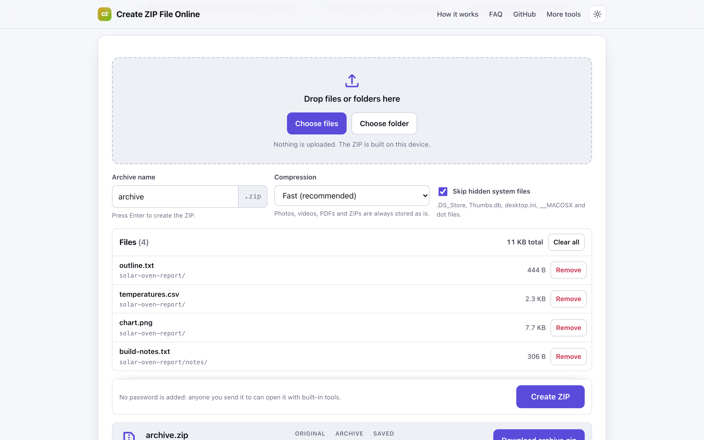
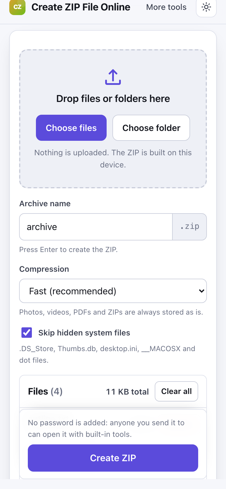

# Create ZIP File Online

> Pick or drop files and folders and build a ZIP right in your browser, with a compression level and no upload.

**🌐 Use it now: [turhe123.github.io/zip-files-local](https://turhe123.github.io/zip-files-local/)** · free · open source · runs in your browser · works offline


## Why

Create ZIP File Online is a free, open-source alternative to tools like ezyZip Create Zip, which come with an ad-ridden page, file count and size limits, some sites that upload your files to build the archive, and nag screens to buy a pro plan. Here your files never leave the device, there is no account, no ads and no limit on how often you use it, it works offline, and you can install it as an app.

## Screenshots

<p align="center"></p>

<p align="center"><em>Create ZIP File Online in the browser, light theme</em></p>

<p align="center"></p>

<p align="center"><em>Create ZIP File Online on a phone</em></p>

## Features

- Drag and drop files or whole folders onto the page. Folders are walked recursively with the directory entry API, so relative paths are kept inside the archive.
- **Choose files** and **Choose folder** buttons (the folder button uses `webkitdirectory`, which also covers browsers where folder drop is not available).
- File list with name, relative path, size, a per-file **Remove** button, a running total and **Clear all**.
- Archive name field, defaulting to `archive` (the `.zip` extension is added for you). Press Enter in the field to create the ZIP.
- Compression level: **Store**, **Fast** (default) or **Best**.
- Files that are already compressed (JPG, PNG, MP4, ZIP, PDF, Office documents, audio and similar) are always stored as they are, since deflating them again saves almost nothing.
- Option to skip hidden system files (`.DS_Store`, `Thumbs.db`, `desktop.ini`, `__MACOSX` and dot files), on by default, with a notice listing what was skipped.
- Compression runs in a Web Worker with [fflate](https://github.com/101arrowz/fflate), so the page stays responsive. A progress bar shows the current file.
- Each entry keeps the file's last-modified time. Names are written as UTF-8, paths use forward slashes, and duplicate names get numbered suffixes such as `report (2).txt`.
- After building, the result shows the original size, the archive size and the percentage saved, plus a download link. The archive is also downloaded automatically.
- Files that cannot be read are skipped, and a visible error lists them.
- No password is added, so the ZIP opens with the built-in tools on Windows, macOS, ChromeOS, Android and iOS.
- Keyboard friendly: the drop zone is a labelled file input and the remove buttons are in tab order. Light and dark themes, usable at 390px wide.
- Installable and offline-ready through a service worker.

**Input:** any files or folders your browser can read.
**Output:** a single standard `.zip` archive (deflate or stored entries).

**Limits:** there is no file count limit. The archive is built in memory, so the tool refuses totals above 2 GB, and on phones and tablets it warns above about 500 MB. The ZIP is not split into parts and is not encrypted.

## How to use

1. Drop files or folders on the box, or press **Choose files** or **Choose folder**.
2. Check the list and remove anything you do not want in the archive.
3. Set the archive name and a compression level, and decide whether to skip hidden system files.
4. Press **Create ZIP**. The progress bar runs while the archive is built on your device.
5. Check the before and after sizes, then use the **Download** button if the file did not save by itself.

## Privacy

- Nothing is uploaded. Files are read and zipped in your browser and never sent to a server.
- No cookies and no account.
- Page views are counted anonymously with [GoatCounter](https://www.goatcounter.com/), which is cookieless and open source.
- After the first visit a service worker caches the page, so it works without a connection.

## Run it locally

```sh
git clone https://github.com/turhe123/zip-files-local
cd zip-files-local
python3 -m http.server 4173
```

Then open http://127.0.0.1:4173/. There is no build step.

## Tests

```sh
npm i -D @playwright/test && npx playwright install chromium
npx playwright test
```

## Third-party code

| Library | Version | License |
| --- | --- | --- |
| [fflate](https://github.com/101arrowz/fflate) | 0.8.2 | MIT |

It is vendored in `vendor/fflate/` together with its license.

## Built with AI

Create ZIP File Online was written by [Claude Code](https://claude.com/claude-code) inside an automated pipeline, from a plain-English spec. No code or assets from any commercial product were used; it is a clean-room implementation of a feature set, not a copy.

What that means in practice:

- The full source is in this repo under the MIT license. Read it before you trust it with your files.
- Everything runs in your browser. It makes no network requests except an anonymous, cookieless page-view count (GoatCounter); your files never leave the device.
- The page is tested headless in Chromium (Playwright) before every release, but it has had less human review than hand-written software. Bug reports and pull requests are welcome.

## Support ❤️

If this saved you a trip to an ad-filled site, you can [buy me a coffee on Ko-fi](https://ko-fi.com/leodavidai).

## More free web tools

Find more at [turhe123.github.io/web-tools](https://turhe123.github.io/web-tools/).

Also: [free, open-source Mac apps](https://turhe123.github.io/mac-apps/) built the same way, native Swift, no accounts, no telemetry.

## License

MIT © Or Davidai Bachar
